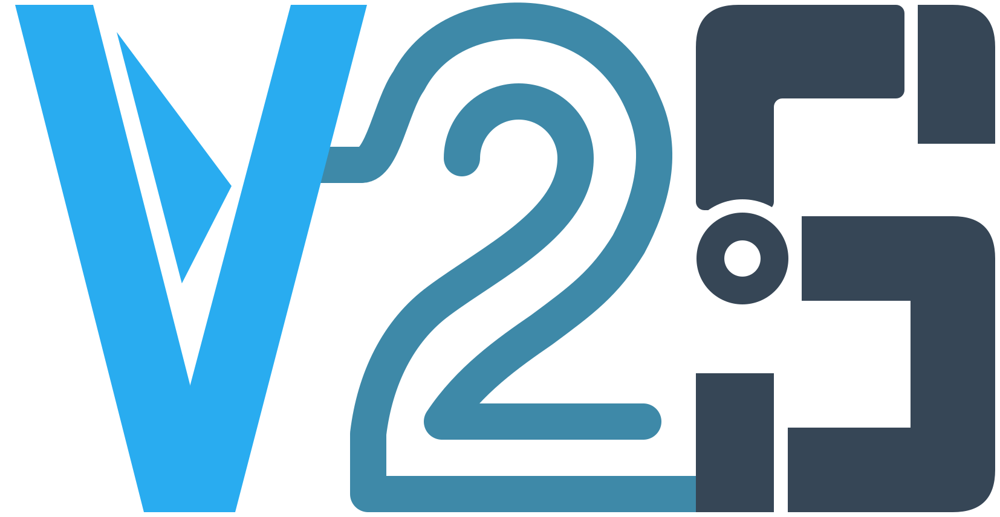

<h1 align="center">Video2Sim · </h1>

<p align="center">
  <b>Film a tabletop. Get a physics-ready USD/URDF scene.</b>
</p>

<p align="center">
  
  
  
</p>

<p align="center">
  <a href="#quick-start">Quick start</a> ·
  <a href="#make-a-scene">Make a scene</a> ·
  <a href="#where-to-read-next">Docs</a>
</p>

---

A smartphone video goes in. SAM 3.1 segments and tracks the objects, SAM 3D completes their
shapes, a reconstruction stage gives them a metric position in the world, and a physics stage adds
collision geometry, mass, inertia and friction ranges. The result loads in Isaac Sim and is meant
as a starting point for reinforcement learning and robot training.

```text
capture -> reconstruction -> segmentation -> shape -> physics -> export
```

## Quick start

```bash
uv sync
cp .env.example .env     # fill in META_MODEL_API_KEY and BASETEN_API_KEY
uv run video2sim doctor  # check the model endpoints; --offline checks keys only
uv run video2sim run my_table.mp4 --out scene/
```

All three model endpoints (VLM, SAM 3D, SAM 3.1) are configurable: [docs/model_interfaces.md](docs/model_interfaces.md).

## Make a scene

1. Film the table per [docs/capture_protocol.md](docs/capture_protocol.md), marker board in view.
2. Set keys in `.env` and deploy the SAM 3D worker on Modal ([AGENTS.md](AGENTS.md) has the commands). Frames and crops are sent to these services.
3. Run `uv run video2sim run my_table.mp4 --out scene/` (`--run-id` resumes; `--quiet` / `--verbose` control progress on stderr).

`scene/` holds `scene.usd`, one URDF per object in `urdf/`, and `qa_report.html` (confidence, fallbacks, mass range, settling result). For the pick-and-place demo, run [scripts/fetch_panda.sh](scripts/fetch_panda.sh) and see [benchmark/run_pick_place.py](benchmark/run_pick_place.py).

## Acknowledgements

Inference for the project research was supported with free credits from [Meta](https://dev.meta.ai) (SAM 3.1 through the Meta Model API), [Modal](https://modal.com) (GPU hosting for the SAM 3D worker), and [Baseten](https://www.baseten.co) (hosted VLM inference). Thank you for making this work possible!

## Where to read next

| File | What it tells you |
| --- | --- |
| [PLAN.md](PLAN.md) | Scope, targets, phases, task list, risks, decisions. |
| [AGENTS.md](AGENTS.md) | Conventions and working rules, for people and coding agents. |
| [benchmark/README.md](benchmark/README.md) | How benchmark scenes and ground truth are laid out. |
| [docs/capture_protocol.md](docs/capture_protocol.md) | How to film a scene. |
| [docs/model_interfaces.md](docs/model_interfaces.md) | Hooking up your own VLM, SAM 3D and SAM 3.1 instances, or swapping the models. |
| [docs/licenses.md](docs/licenses.md) | License status of every model and tool we depend on. |
| [docs/final_benchmark.md](docs/final_benchmark.md) | End-to-end results on the test split (P5.6). |
